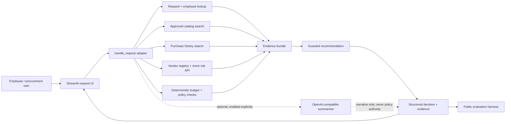

# Architecture and workflow

## Components

## Tool boundaries

1. `request_context`: validates the request's requester against the employee directory.
2. `software_catalog_search`: retrieves existing approved products matching the vendor, product, or category.
3. `purchase_history_search`: retrieves prior purchases from the requested vendor.
4. `vendor_registry_and_risk_api`: compares the local registry against the mock vendor-risk service.
5. `deterministic_budget_policy`: looks up available departmental budget; code then applies explicit dollar thresholds.

The API is a required evidence source. HTTP errors are recorded as unavailable evidence and lead to manual Security review, never to an inferred favorable status. Date checks use the policy's fixed 2026-09-30 reference date.

## Architectures evaluated

- **Single:** one agent workflow gathers the tool evidence and returns a decision using the deterministic policy function.
- **Staged:** the Evidence Analyst gathers the same evidence and the Policy Reviewer separately applies deterministic rules. Its output includes a traceable stage marker. The stages do not give an LLM authority over approvals.

When `ENABLE_LLM=true` and `OPENAI_API_KEY` is configured, the single path makes one OpenAI-compatible JSON-mode call to summarize the stated business purpose. The staged path adds a second call to summarize the already-determined route. Generated text is labelled non-authoritative and cannot change approvals, risk flags, missing information, or next action. Without explicit opt-in, both architectures run locally without LLM calls or credentials.

## Human controls and assumptions

- Every result remains advisory and marks `human_review_required=true`.
- Financial thresholds, budget comparisons, risk flags, and required approval groups are deterministic.
- Requester/vendor notes are untrusted input. Injection-like text is detected and cannot modify policy.
- Catalog matching is intentionally conservative: exact product/vendor and same-category candidates are surfaced as overlap for human evaluation; overlap is not an automatic rejection.
- Current public data is synthetic. A production deployment would need authenticated identity, authorization, audit retention, live source-of-truth connectors, and approved model/data-handling controls.
